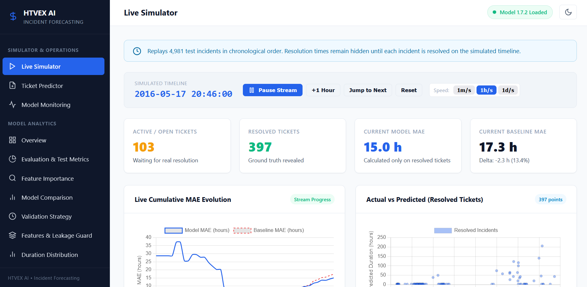
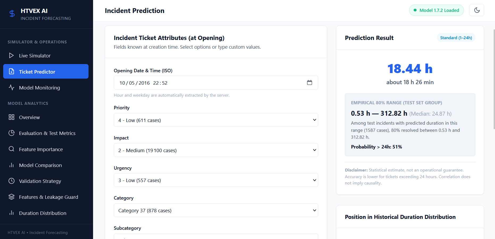
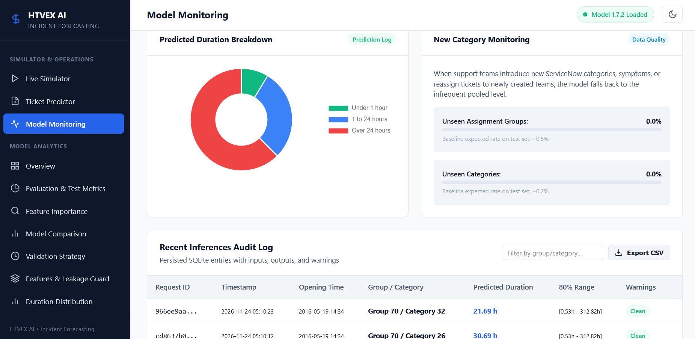

# HTVEX AI — IT Incident Resolution Forecasting

HTVEX AI estimates how long an IT incident will take to resolve using information available when the ticket is opened. The project includes a trained `HistGradientBoostingRegressor`, a FastAPI API, and a web interface for individual and batch predictions, historical incident replay, and prediction monitoring.

The trained model and evaluation artifacts are included. The notebooks document the analysis and training workflow; they are not required to run the application.

## Screenshots







---

## Project structure

```text
ML_IT_Incident_MAIN-FINAL/
├── notebooks/                       # Analytical workflow and model development
│   ├── 01_data_understanding.ipynb
│   ├── 02_data_quality_audit.ipynb
│   ├── 03_target_and_incident_reconstruction.ipynb
│   ├── 04_eda.ipynb
│   ├── 05_features_split_models.ipynb
│   ├── 06_tuning_and_selection.ipynb
│   ├── 07_final_evaluation_and_interpretation.ipynb
│   └── 08_final_notebook.ipynb     # Consolidated analytical reference
├── src/                             # Core pipeline modules
│   ├── config.py                    # Schema definitions and configuration
│   ├── data_loading.py              # Event log ingestion
│   ├── reconstruction.py            # Event aggregation to incident level
│   ├── features.py                  # Opening-moment feature extraction & date splits
│   ├── pipelines.py                 # Scikit-learn preprocessor and regressor pipelines
│   ├── metrics.py                   # MAE, RMSE, RMSLE regression metrics
│   └── export_artifacts.py          # Pipeline artifact generator (python -m src.export_artifacts)
├── artifacts/                       # Pre-computed model bundle and evaluation artifacts
│   ├── model/
│   │   ├── final_pipeline.joblib    # Trained HistGradientBoosting pipeline (train+validation)
│   │   └── model_card.json          # Model hyperparameters, environment, and evaluation metadata
│   ├── metrics/                     # Test evaluations, subgroup errors, and feature importance
│   ├── eda/                         # Target distribution and category duration breakdowns
│   ├── options.json                 # Frequency-weighted category levels for inference forms
│   └── replay/
│       └── test_incidents.csv       # 4,981 test incidents for live stream replay
├── app/                             # FastAPI service and web interface
│   ├── routes/                      # Prediction, replay, monitoring, and dashboard routes
│   ├── services/                    # Model loading, SQLite log, and artifact access
│   ├── schemas.py                   # Request and response validation
│   ├── static/                      # CSS, JavaScript, and Chart.js
│   ├── templates/                   # Jinja2 pages
│   ├── config.py                    # Application settings and relative paths
│   └── main.py                      # FastAPI application entry point
├── tests/                           # Automated test suite (artifacts, API, validation, parity)
├── docker-compose.yml               # Application service
├── Dockerfile                       # Container build
├── .dockerignore
├── requirements-app.txt             # API and inference dependencies
└── requirements.txt                 # Analysis, training, and test dependencies
```

---

## Machine Learning Workflow

The analysis uses 24,905 resolved incidents from 141,712 event records. For each incident, only information available in the first event is used. Information added later is excluded to avoid data leakage.

The data is split by date into three sets:
- **Training:** oldest 60% (14,943 tickets).
- **Validation:** next 20% (4,981 tickets).
- **Test:** last 20% (4,981 tickets).

The selected model is `HistGradientBoostingRegressor`. It uses `log1p(hours)` as the target and `OneHotEncoder` to handle categorical features. The model was trained again using the training and validation sets (19,924 tickets), then evaluated once on the test set.

The final test results are:

| Metric | Model | Running Median Baseline | Improvement |
|---|---:|---:|---:|
| **MAE** | **117.24 h** | 132.49 h | **11.5%** |
| **RMSE** | **419.16 h** | 454.66 h | **7.8%** |
| **RMSLE** | **1.74** | 2.44 | **28.7%** |
| **95% Bootstrap CI (MAE reduction)** | **[4.9, 26.0] h** | — | Confirmed gain |
| **Median Signed Error** | **+0.7 h** | -109.5 h | Better calibration |

### Operational Boundaries

1. **Long incidents:** Incidents taking more than 24 hours represent 36% of the test data but account for 91% of the model's total error. The model works better on short, routine tickets (MAE of 8.2 h compared with 20.4 h for the baseline). However, it often underestimates the duration of long and complex incidents.

2. **Association, not causation:** `assignment_group` and `sys_created_by` are the most important features. However, the results only show patterns in historical data. They do not prove that changing a ticket's assignment will change its resolution time.

The original event-log CSV is not included in this repository. It is only needed to run the notebooks again or rebuild the exported files. To do this, place it at `data/raw/incident_event_log.csv`.

---

## Getting started

### Option 1 — Docker (recommended)

Install Docker Desktop, then run this command from the project root:

```bash
docker compose up --build
```

Open **http://localhost:8000** to use the application.

| Page | URL | Description |
|---|---|---|
| Ticket Predictor | http://localhost:8000/predict | Score an incident or upload a CSV |
| Live Simulator | http://localhost:8000/replay | Replay test incidents; progress resumes after visiting other pages |
| Model Monitoring | http://localhost:8000/monitoring | Review saved predictions and input warnings |
| Project Overview | http://localhost:8000/overview | Review model results and analysis |
| Operational Limits | http://localhost:8000/limits | Review model constraints and appropriate use |
| API Health | http://localhost:8000/health | Check service and model status |
| API Documentation | http://localhost:8000/docs | OpenAPI documentation |

Stop the application with `Ctrl+C`, or run `docker compose down`. Prediction history is stored in the `app_data` volume and persists across container restarts. To remove it, run `docker compose down --volumes`.

---

### Option 2 — Manual setup

Prerequisites: Python 3.11 or later. This installs only the API and model inference dependencies.

In the project root, create a virtual environment and install the dependencies:

```powershell
python -m venv .venv
.\.venv\Scripts\Activate.ps1
python -m pip install -r requirements-app.txt
```

Launch the application:

```powershell
python -m uvicorn app.main:app --reload
```

Open **http://localhost:8000** in your browser.

To rebuild the model and analysis artifacts, first provide the source CSV at `data/raw/incident_event_log.csv`, then run:
```powershell
python -m src.export_artifacts
```

---

## Configuration

Docker Compose reads `PORT` from the project `.env` file to set the host port. The default is `8000`; for example, set `PORT=8080` to use **http://localhost:8080**.

| Variable | Default | Description |
|---|---|---|
| `PORT` | `8000` | Host port exposed by Docker Compose |

---

## API specification

| Method | Endpoint | Purpose |
|---|---|---|
| `GET` | `/health` | Application status, loaded pipeline verification, and artifact check |
| `GET` | `/api/v1/model` | Model card metadata, training parameters, and baseline metrics |
| `GET` | `/api/v1/options` | Frequency-weighted category levels for ticket dropdowns |
| `POST` | `/api/v1/predict` | Score an individual incident ticket (strictly rejects post-opening fields with 422) |
| `POST` | `/api/v1/predict/batch` | Score up to 500 incident tickets in a single request |
| `GET` | `/api/v1/simulation/incidents` | Chronologically ordered test incidents for stream replay (ground truth hidden) |
| `GET` | `/api/v1/monitoring/summary` | Aggregate prediction statistics, warning rates, and drift indicators |
| `GET` | `/api/v1/monitoring/predictions` | Paginated SQLite inference audit log entries |
| `GET` | `/api/v1/evaluation/errors-by-group` | Subgroup error metrics by duration class, priority, or category |
| `GET` | `/api/v1/interpretation/importance` | Permutation feature importance on test split |
| `GET` | `/docs` | Interactive Swagger documentation |

`POST /api/v1/predict` requires `opened_at` (ISO timestamp) and accepts the 11 supported ticket attributes: `priority`, `impact`, `urgency`, `category`, `subcategory`, `u_symptom`, `assignment_group`, `location`, `contact_type`, `opened_by`, and `sys_created_by`. Unsupported fields return HTTP 422.

---

## Validation & test suite

Run the test suite from the project root:

```powershell
python -m pytest -v tests
```

The tests cover artifact integrity, API endpoints, rendered pages, request validation, and prediction parity with the saved model. Install the full `requirements.txt` first; it includes additional analysis, notebook, and test packages.
